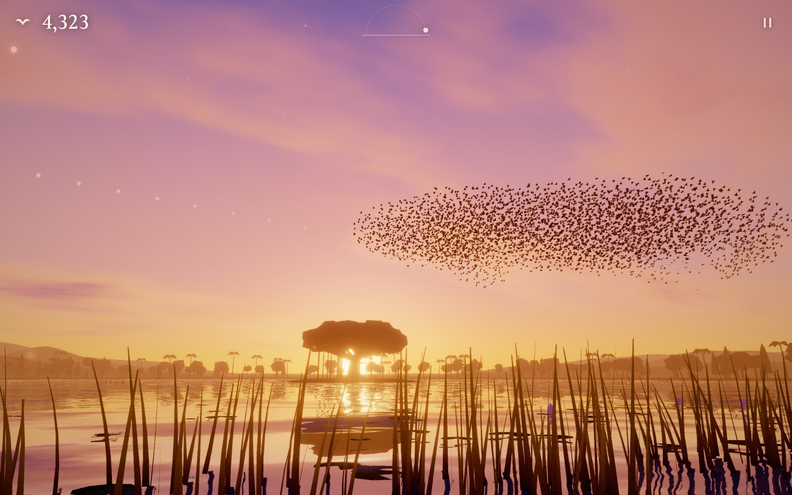
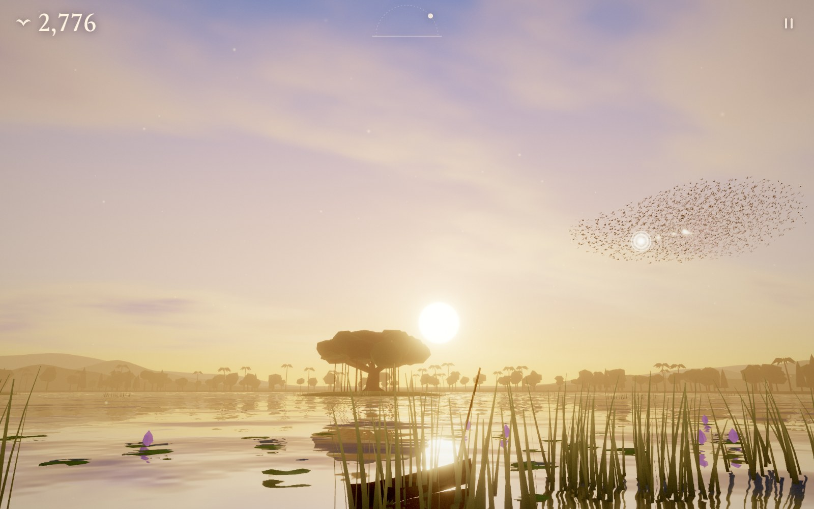
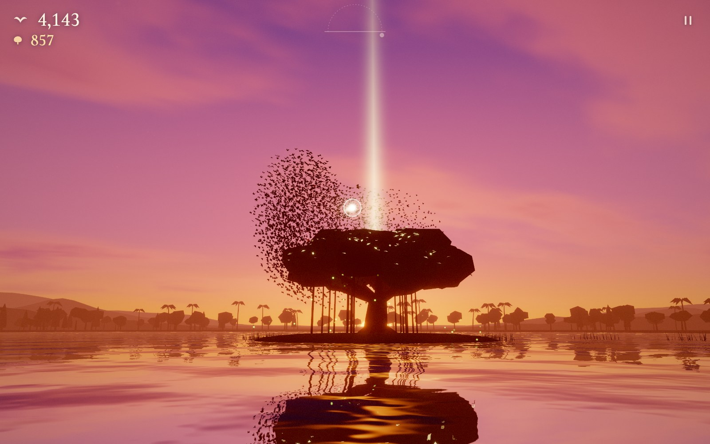
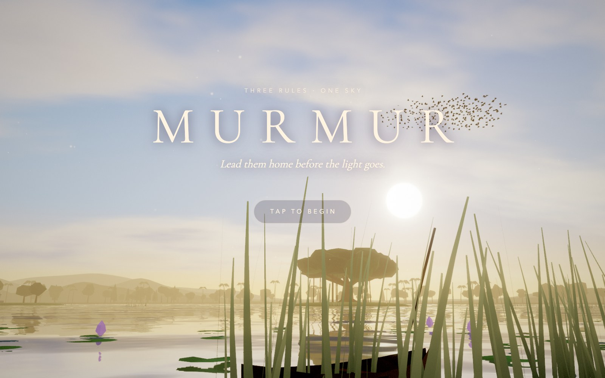
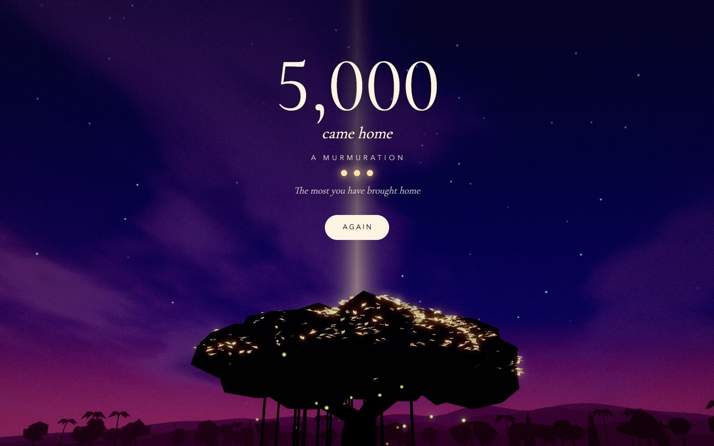

# Murmur

*Three rules. One sky.*

Lead a murmuration of starlings across a lake at dusk. Sweep up the wisps of strays that cross the sky, scatter when the falcon dives, and bring every bird home to the banyan before the light goes.



| | |
|---|---|
|  |  |
|  |  |

No bird in the flock is scripted. Each one follows three rules about the handful of birds nearest to it (keep apart, fly the same way, stay close) and the player adds a fourth: the pull of a place. The ribbons, the lens shapes, the hole that opens round the falcon and the pour into the tree at dusk are all what those rules do by themselves when a few thousand birds follow them at once.

## Play

It is a static site with ES modules, so it needs to be served (it will not run from `file://`):

```
python3 playtest/serve.py        # then open http://127.0.0.1:8377
```

Any static host works the same way (Vercel, GitHub Pages): there is no build step.

| | Touch | Mouse | Keyboard |
|---|---|---|---|
| Lead the flock | drag | move | arrows / W A S D |
| Scatter (the flare) | quick tap, or a second finger | click | Space |
| Pause | the button | the button | Esc / P |
| Sound | pause card | pause card | M |

One evening lasts about four minutes: 165 seconds of golden hour and sunset, the call home when the sun touches the bank, up to 55 seconds of blue hour to roost, then night. The score is the number of birds that came home.

`?lan=hi` plays in Hindi.

## What is in here

```
index.html            the page: canvas, title, HUD, pause and result cards
styles/main.css       type and controls (touch first)
vendor/three.module.js  Three.js r170, core only (MIT)
src/main.js           boot, the frame loop, adaptive resolution, the shared context (window.__mm)
src/engine/           camera director, HDR post pipeline, clock + scripts, tweens, input, audio, strings
src/world/            sky (the clock), water (planar reflection), land, flock, falcon, lure, small lights
src/game/flow.js      the evening: title → play → call → roost → finale
src/game/dev.js       URL switches and the state the playtests read
src/ui/hud.js         everything DOM
playtest/             Python Playwright tests and screenshot tools
docs/GDD.md           the design, and why each part is the way it is
```

Everything on screen and everything you hear is made in code: no textures, no models, no sound files. The only binary assets are the display font and the README's screenshots.

The engine core (`camera.js`, `post.js`, `clock.js`, `tween.js`, `util.js`) is carried over from Spaceship Mission and trimmed for this game.

## Dev switches

| Parameter | What it does |
|---|---|
| `?dev=1` | read-out: fps, simulation ms, birds, phase |
| `?start=1` | skip the title |
| `?auto=1` | the autopilot plays (with `start=1`, a whole evening unattended) |
| `?fast=N` | N simulation steps per frame |
| `?at=120` | jump to this second of the evening once play starts |
| `?flock=N` | start with N extra birds already in the flock |
| `?tod=0.62` | hold the sky at a time of day (title only) |
| `?nofalcon=1` `?noflare=1` | no falcon / an autopilot that never flares |
| `?birds=N` `?seed=N` `?dpr=N` `?mute=1` | bird cap, the evening's seed, render scale, silence |

`window.__mm.dev.state()` returns the phase, the counts and the timings.

## Tests

Python Playwright with Chromium on the real GPU (`pip install playwright && playwright install chromium`):

```
python3 playtest/evening.py                 # a whole evening on autopilot: phases, falcon results, final count
python3 playtest/hands.py                   # the controls, with real mouse, keyboard and touch events
python3 playtest/shot.py name=query ...     # screenshots of any URL state
python3 playtest/strip.py "query" --n 6     # a film strip of one run
```

Screenshots go to `playtest/screens/` (not tracked).

## Credits

- [Three.js](https://threejs.org) r170, MIT licence.
- Cormorant Garamond by Christian Thalmann, SIL Open Font Licence 1.1 (`assets/fonts/`).
- The flocking model follows Craig Reynolds' boids (1987), with the fixed number of neighbours per bird that Ballerini et al. measured in real starling flocks (2008).
