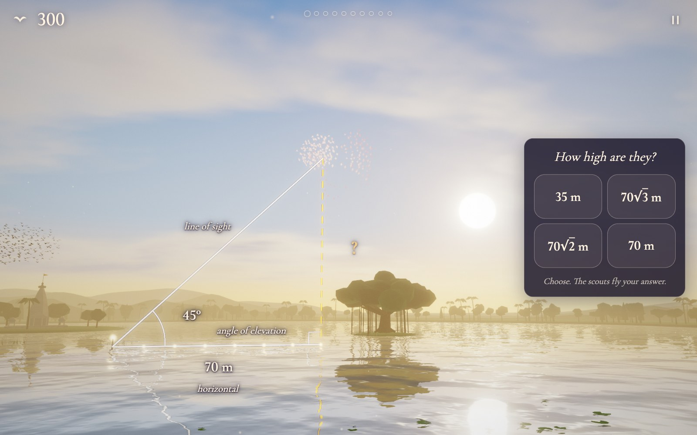
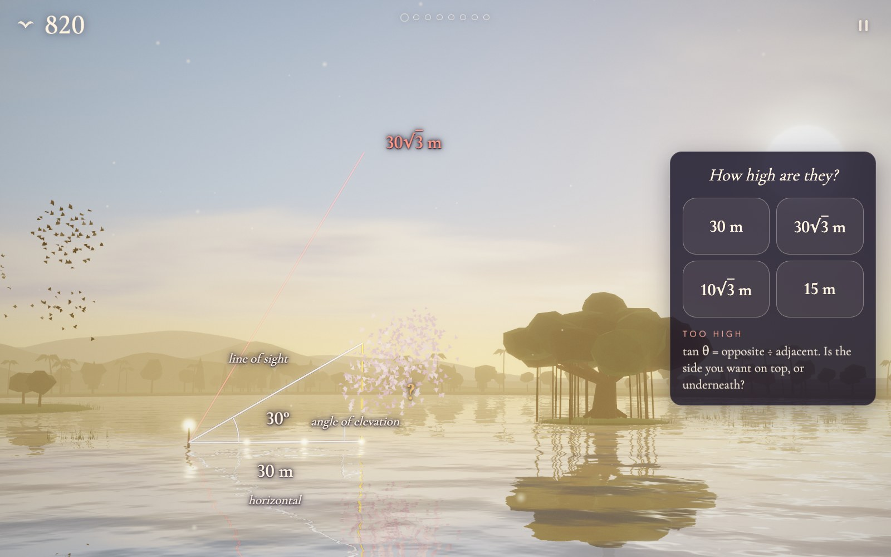
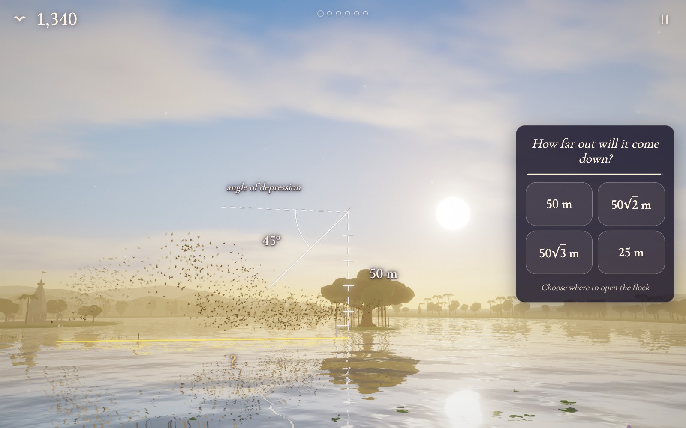
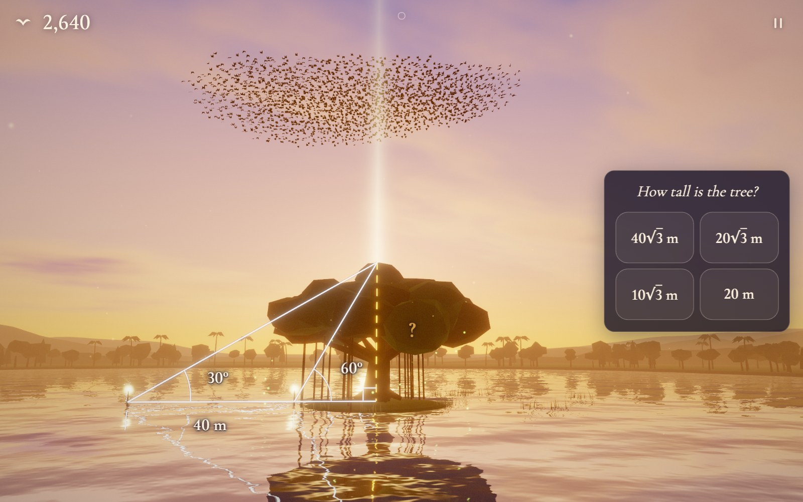
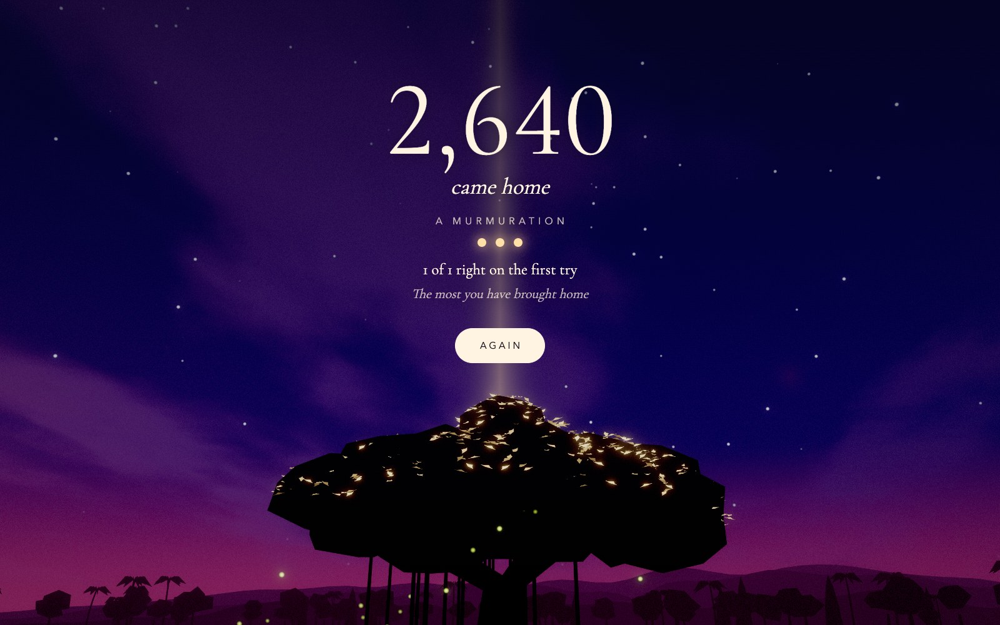

# Murmur

*Heights and distances, at dusk.*

A maths game for **Class 10, "Some Applications of Trigonometry"**. Wisps of stray starlings circle above a lake. Each one is a right triangle standing on the water: a lamp, a distance, an angle, a height. Work out the missing part and your scouts fly exactly that answer. Get it right and the strays join your flock; get it wrong and you watch your answer miss, by how much and in which direction. By dark, bring everyone home to the banyan.



| | |
|---|---|
|  |  |
|  |  |

## What the player does

One evening is ten questions and takes about eight minutes.

| | | The question | The maths |
|---|---|---|---|
| 1–4 | Sightings | How high are they? How far out are they? | tan 45°, tan 60°, tan 30°; height from distance, distance from height |
| 5 | The falcon | How far out will it come down? (35 seconds) | angle of depression; it equals the angle of elevation from below |
| 6–8 | Sightings | How long is the line of sight? What is the angle of elevation? | sin and cos; finding the angle from two sides |
| 9 | The falcon | again, harder | |
| 10 | The banyan | How tall is the tree? | two angles of elevation, 30° and 60°, from lamps 40 m apart |

- **The triangle is in the world.** The lamp is where you stand, a floating diya marks every 10 m of water, a plumb line drops from the strays, the angle is drawn at the lamp. The first one arrives with its words: *horizontal*, *line of sight*, *angle of elevation*.
- **Your answer is flown.** Scouts carry a light along the line your answer makes. Too low, too high, too short, too far: you see it.
- **Every wrong option is a particular mistake** (the ratio upside down, the wrong ratio, the wrong value for the angle, the wrong side). A miss is answered with the idea that was missing, never with the answer.
- **The hint ladder.** First miss: the idea. Second: the set-up (`tan 60° = height ÷ 30`). Third: the whole working, a line at a time, and the scouts fly it for you. Nobody is ever stopped.
- **Misses cost birds.** A third of the wisp leaves with each one. The score is the number of birds that came home, so it measures accuracy and nothing else.
- **Between questions you lead the flock by hand** to the next lamp, sweeping up fledglings on the way, and at the end you pour them into the tree.

`?lan=hi` plays in Hindi, with the NCERT terms (उन्नयन कोण, अवनमन कोण, दृष्टि रेखा).

## Play

It is a static site with ES modules, so it needs to be served (it will not run from `file://`):

```
python3 playtest/serve.py        # then open http://127.0.0.1:8377
```

Any static host works the same way (Vercel, GitHub Pages, VS Code Live Server): there is no build step.

| | Touch | Mouse | Keyboard |
|---|---|---|---|
| Answer | tap an option | click an option | 1 2 3 4 |
| Lead the flock | drag | move | arrows / W A S D |
| Pause | the button | the button | Esc / P |
| Sound | pause card | pause card | M |

## What is in here

```
index.html            the page: canvas, title, HUD, the answer dock, pause and result cards
styles/main.css       type and controls (touch first)
vendor/three.module.js  Three.js r170, core only (MIT)
src/main.js           boot, the frame loop, adaptive resolution, the shared context (window.__mm)
src/game/problems.js  the maths: six kinds of question, their numbers, their wrong options and what each one means
src/game/flow.js      the evening: title → (transit → sighting) × 7, two falcons, the banyan → roost → finale
src/game/dev.js       URL switches and the state the playtests read
src/ui/dock.js        the answer dock and the labels pinned to the triangle
src/ui/hud.js         title, counts, question pips, stamps, pause and results
src/engine/           camera director, HDR post pipeline, clock + scripts, tweens, input, audio, strings
src/world/            sky (the clock), water (planar reflection), land, flock, falcon, lines, lamps and small lights
playtest/             Python Playwright tests and screenshot tools
docs/GDD.md           the design, and why each part is the way it is
```

Everything on screen and everything you hear is made in code: no textures, no models, no sound files. The only binary assets are the display font and this README's screenshots.

The flock is simulated, not animated: every bird follows three rules about its nearest neighbours (keep apart, fly the same way, stay close) and a fourth the game supplies, the pull of a place. The engine core (`camera.js`, `post.js`, `clock.js`, `tween.js`, `util.js`) is carried over from Spaceship Mission.

## Dev switches

| Parameter | What it does |
|---|---|
| `?dev=1` | read-out: fps, simulation ms, birds, phase, question |
| `?start=1` | skip the title |
| `?auto=1` | the autopilot plays (with `start=1`, a whole evening unattended) |
| `?miss=N` | the autopilot answers wrong N times before it answers right (shows the hint ladder) |
| `?q=N` | start the evening at its Nth question (0–9), with a flock to match |
| `?fast=N` | N simulation steps per frame |
| `?tod=0.62` | hold the sky at a time of day (title only) |
| `?birds=N` `?seed=N` `?dpr=N` `?mute=1` `?lan=hi` | bird cap, the evening's numbers, render scale, silence, Hindi |

`window.__mm.dev.state()` returns the phase, the question, the counts and the timings.

## Tests

Python Playwright with Chromium on the real GPU (`pip install playwright && playwright install chromium`):

```
python3 playtest/evening.py                 # a whole evening on autopilot: every question, the final count
python3 playtest/evening.py --miss 3        # ... answering wrong three times each, through the whole hint ladder
python3 playtest/hands.py                   # the game with real mouse, keyboard and touch events (27 checks)
python3 playtest/shot.py name=query ...     # screenshots of any URL state
python3 playtest/strip.py "query" --n 6     # a film strip of one run
```

Screenshots go to `playtest/screens/` (not tracked).

## Credits

- [Three.js](https://threejs.org) r170, MIT licence.
- Cormorant Garamond by Christian Thalmann, SIL Open Font Licence 1.1 (`assets/fonts/`).
- The flocking model follows Craig Reynolds' boids (1987), with the fixed number of neighbours per bird that Ballerini et al. measured in real starling flocks (2008).
